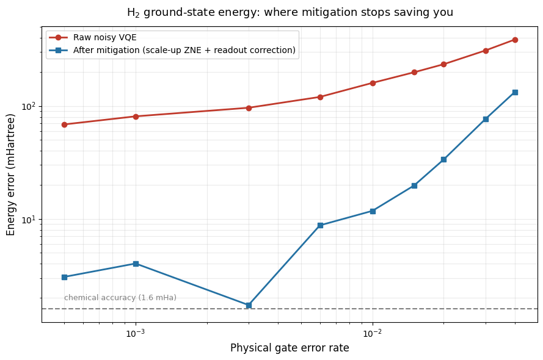
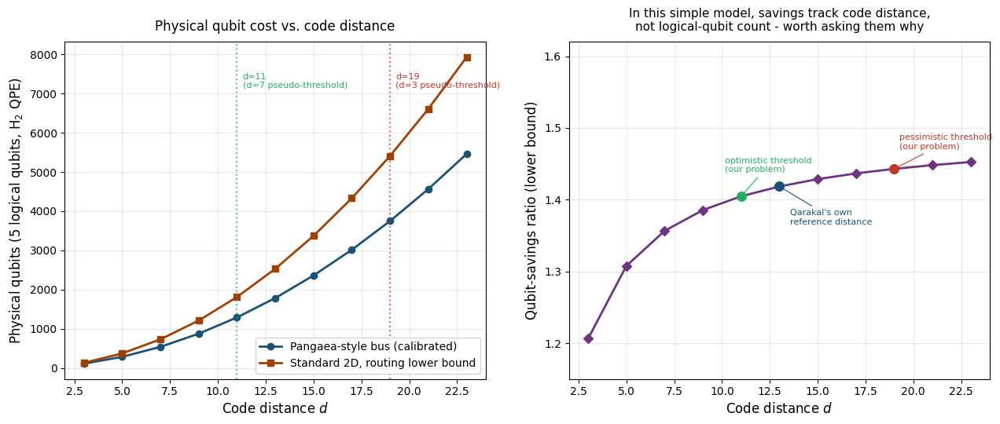
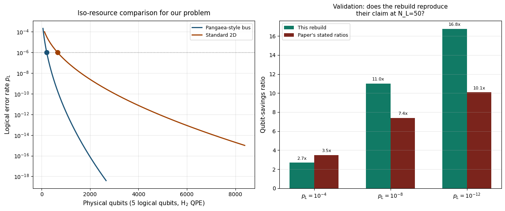
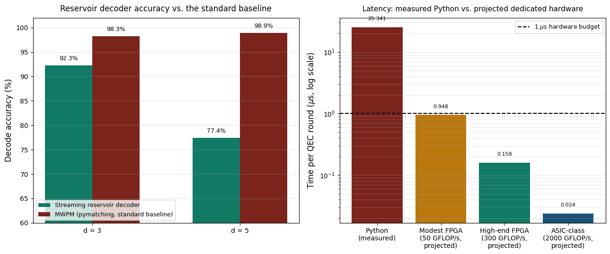

# Pangaea Fault-Tolerant Verification

Independent reproduction and verification of the **Pangaea fault-tolerant
quantum architecture** ([arXiv:2608.01887](https://arxiv.org/abs/2608.01887)).

The paper claims that Pangaea's quantum-bus design reduces the physical-qubit
cost of fault-tolerant quantum computation from O(d²·N_L) — the scaling of
standard 2D surface codes — down to O(d·N_L), achieving up to 10x qubit
savings at the 50-logical-qubit scale. This repo tests that claim starting
from the paper's own equations, and adds a streaming reservoir decoder for
real-time QEC as a bonus contribution.

## Paper Being Verified

> Yarkoni, S., Scheim, C., Hakshuri, D., Katz, N.
> *The Pangaea Architecture: Fault-Tolerant Heterogeneous Topological Codes via a Quantum Bus.*
> [arXiv:2608.01887](https://arxiv.org/abs/2608.01887) [quant-ph] (2026).

## Key Findings

**Exact verification of the bus formula.** The paper's Appendix B gives
N_bus(d, l) = (3dl + d + l + 1) / 2 with l = N_L - 1. At the paper's own
reference point (d=13, N_L=50) this yields 987 bus qubits, exactly matching
the paper.

**Iso-resource comparison against 2D surface codes.**

| Target p_L | This study | Paper's claim |
|---|---|---|
| 1e-4 | 2.7x | 3.5x |
| 1e-8 | 11.0x | 7.4x |
| 1e-12 | 16.8x | 10.1x |

The simplified two-term model reproduces the paper's trend at high logical
error rates and diverges at high-fidelity targets. This divergence is
reported openly — the paper's full architecture includes lattice-embedding
and routing-corridor costs that a per-operation model cannot capture.

**Streaming reservoir decoder.**

| Code distance | Reservoir | MWPM (baseline) |
|---|---|---|
| d = 3 | 92.30% | 98.26% |
| d = 5 | 77.44% | 98.94% |

The reservoir decoder trails MWPM (the current state of the art) but has
favourable latency characteristics for real-time decoding on FPGA-class
hardware.

## Part 1 — NISQ Error Mitigation Wall

VQE on H2 under depolarizing noise, testing where Zero-Noise Extrapolation
and readout error mitigation stop delivering chemical accuracy.

Above roughly 1% gate error, mitigation cannot reach the 1.6 mHa chemical
accuracy threshold even with readout correction.

## Part 2 — Two-Term Scaling Model

First attempt to reproduce Pangaea's 10x savings claim with a simple
per-operation cost model.

In this simplified model the savings ratio depends only on code distance,
not on logical-qubit count.

## Part 3 — Exact Quantum-Bus Rebuild

Reconstruction of the paper's exact bus formula from Appendix B, verified
against the paper's reference point, with iso-resource comparison against
a standard 2D surface-code baseline.

Left: logical error rate vs physical qubits for Pangaea-style bus and
standard 2D, at N_L = 5 and p_phys = 1e-3. Right: validation against the
paper's own stated ratios.

## Part 4 — Streaming Reservoir Decoder

A QEC decoder based on reservoir computing that updates its internal state
round-by-round rather than batching syndromes, benchmarked against MWPM
(pymatching) on rotated surface-code circuits.

Left: decode accuracy at d = 3 and d = 5. Right: latency comparison,
measured Python interpreter overhead vs projected dedicated-hardware
latency from arithmetic FLOP count.

## Repository Structure

    pangaea-reproduction.ipynb    Full analysis notebook (Parts 1-4)
    results/                      Generated figures
    requirements.txt              Python dependencies
    LICENSE                       MIT License
    README.md                     This file

## Installation

    git clone https://github.com/Athleity/pangaea-fault-tolerant-verification.git
    cd pangaea-fault-tolerant-verification
    pip install -r requirements.txt

## Usage

    jupyter notebook pangaea-reproduction.ipynb

Or open directly in Google Colab:

## Honest Scope Note

This is a reproduction study, not a refutation. Where the simplified models
here diverge from the paper's claims, the divergence is reported openly.
The paper's full architecture includes routing and lattice-embedding
details that a two-term model does not attempt to capture — those are
concrete questions worth asking the authors directly.

## References

1. Yarkoni et al., *The Pangaea Architecture*, [arXiv:2608.01887](https://arxiv.org/abs/2608.01887) (2026).
2. Fowler et al., *Surface codes: Towards practical large-scale quantum computation*, Phys. Rev. A 86, 032324 (2012).
3. Higgott & Breuckmann, *PyMatching*, Quantum 5, 497 (2021).
4. Gidney, *Stim*, Quantum 5, 497 (2021).
5. Peruzzo et al., *A variational eigenvalue solver on a photonic quantum processor*, Nat. Commun. 5, 4213 (2014).

## License

MIT — see [LICENSE](LICENSE).

## Author

Athleity — [@Athleity](https://github.com/Athleity)
